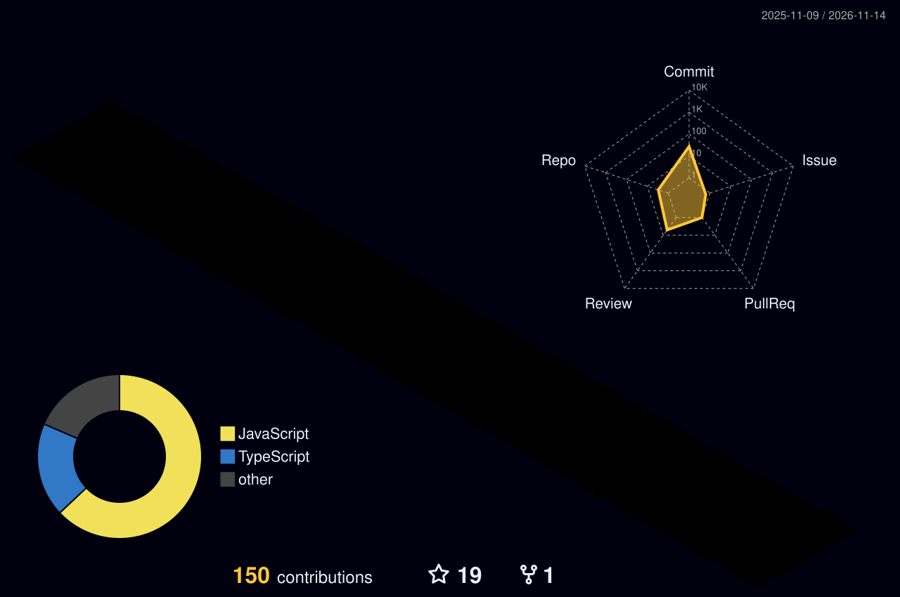

### Salve! Eu sou Gyovani Santos.

Curso Sistemas de Informação na UFS e sou Técnico em Redes de Computadores pelo IFS com experiência centrada em Desenvolvimento WEB. Atualmente sou pesquisador na área de Computação Inteligente, com ênfase em Inteligência Artificial no campo de Visão Computacional, onde, desenvolvo pesquisa apoiada pelo Ministério da Pesca e Agriculta do Brasil. Profissionalmente atuo como um dos CEO's e Fundadores da Human Learning, uma startup focada em soluções tecnológicas inteligentes.

- 🎓 Graduando em Sistemas de Informação | **UFS**
- 🏬 Fundador da Liga Acadêmica de Desenvolvimento Web | [**LAWD**](https://github.com/Lawd-UFS)
- 🔍 Pesquisador do Laboratório para Universalização do Desenvolvimento, Inovação e Inteligência Computacional | [**LUDIICO**](https://www.ludii.co/)

	<picture>
	  <source media="(prefers-color-scheme: dark)"  srcset="https://raw.githubusercontent.com/gyovani19/gyovani19/output-3d-contrib/night.svg" />
	  <source media="(prefers-color-scheme: light)" srcset="https://raw.githubusercontent.com/gyovani19/gyovani19/output-3d-contrib/day.svg" />
	  
	</picture>

  
  
🌐 Desenvolvimento Web

🖥️ Programação de Baixo Nível

⚙️ Machine Learning e IA

🛠️ Sistemas e Infraestrutura

  

     

